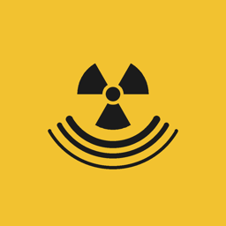
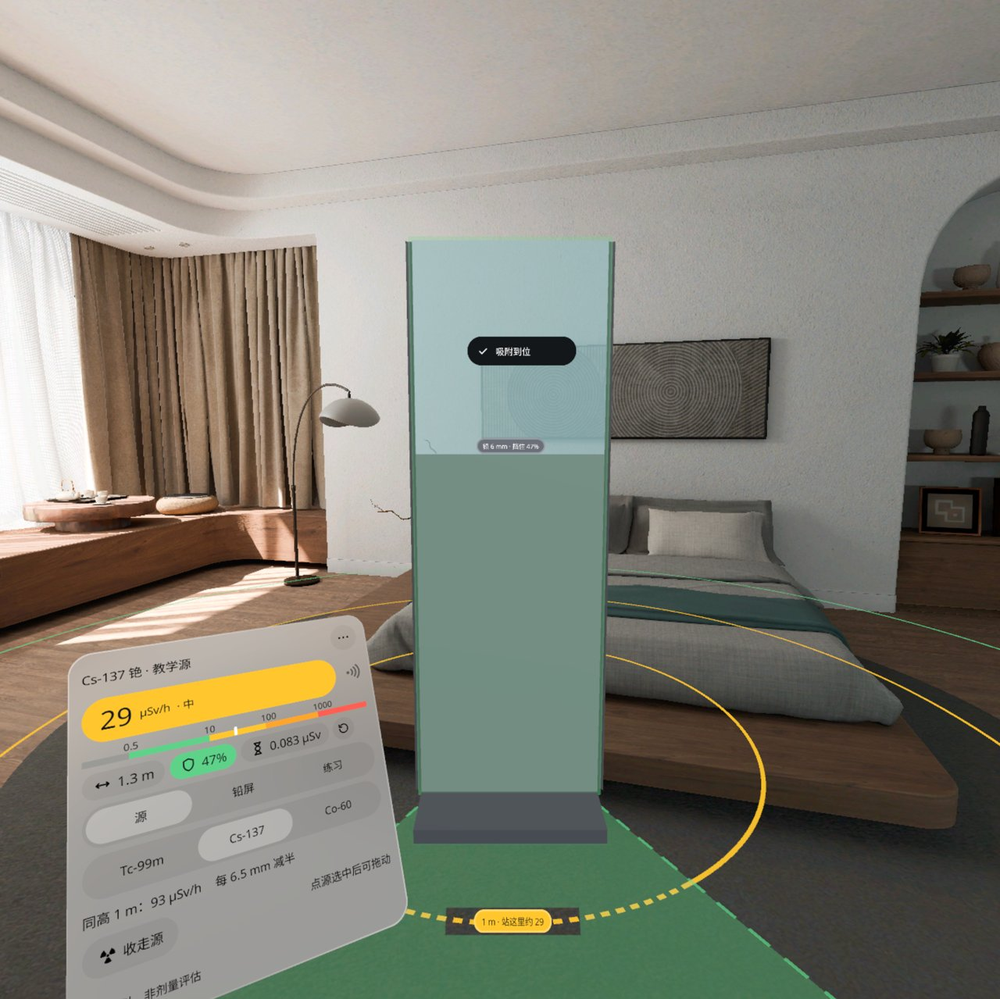
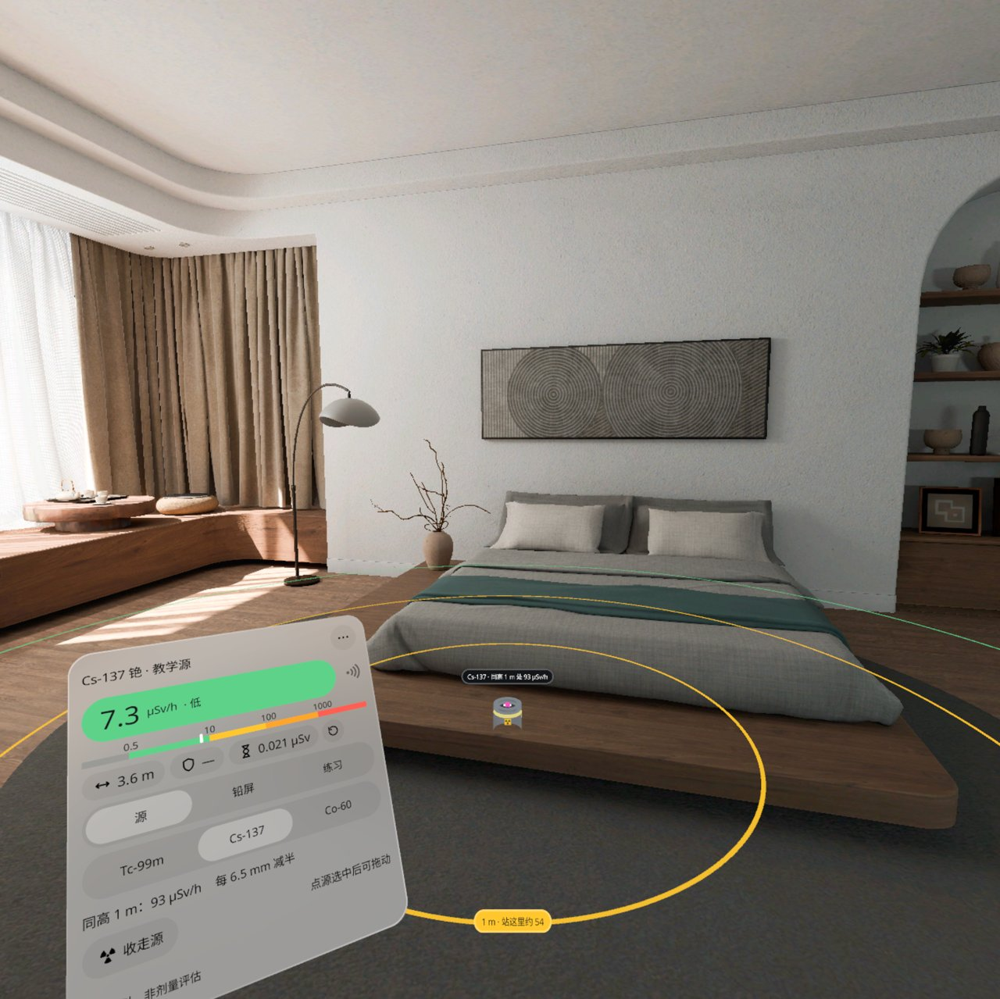
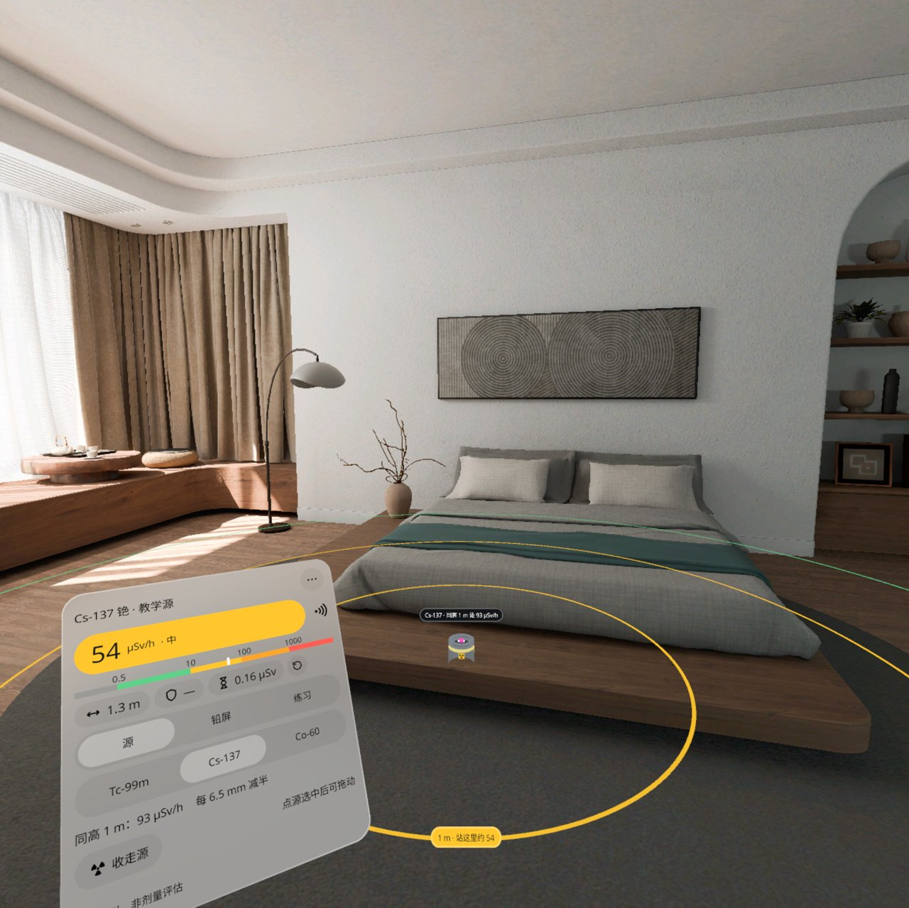
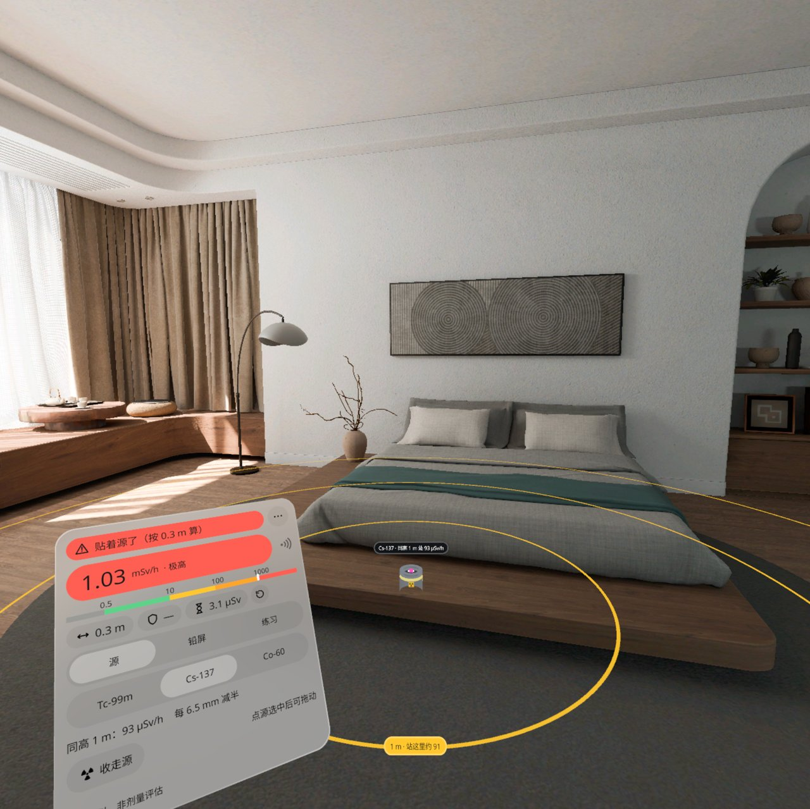
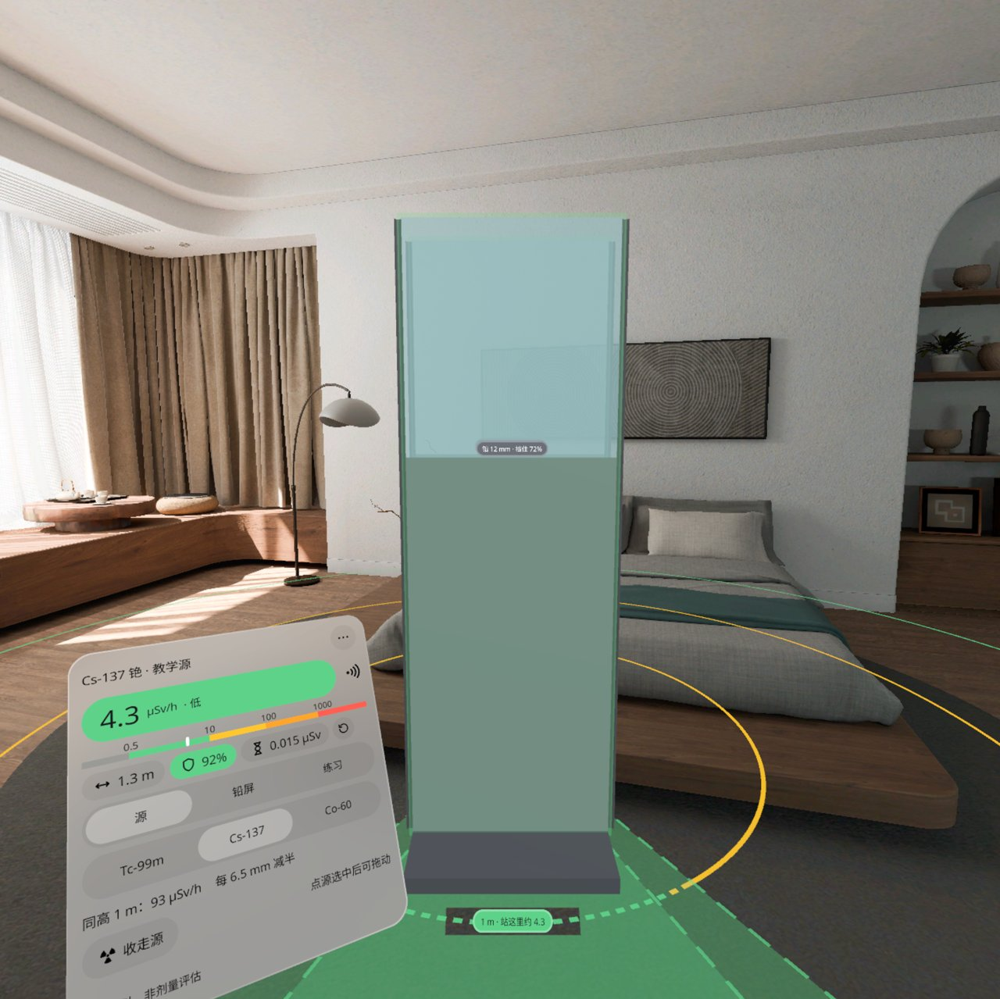
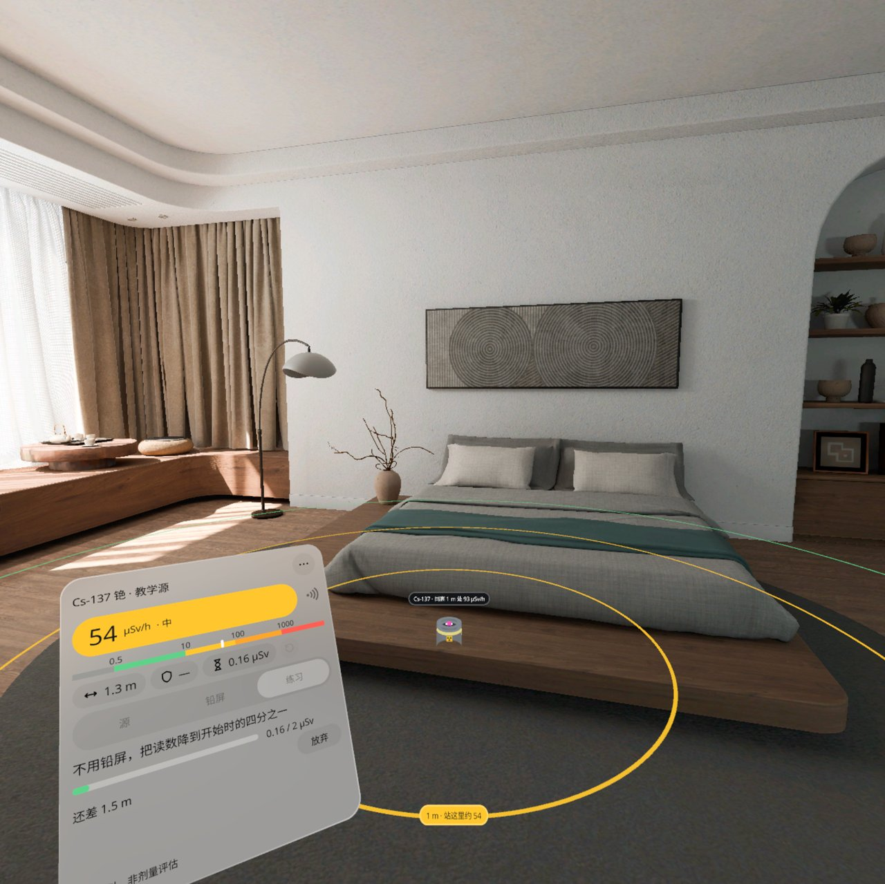
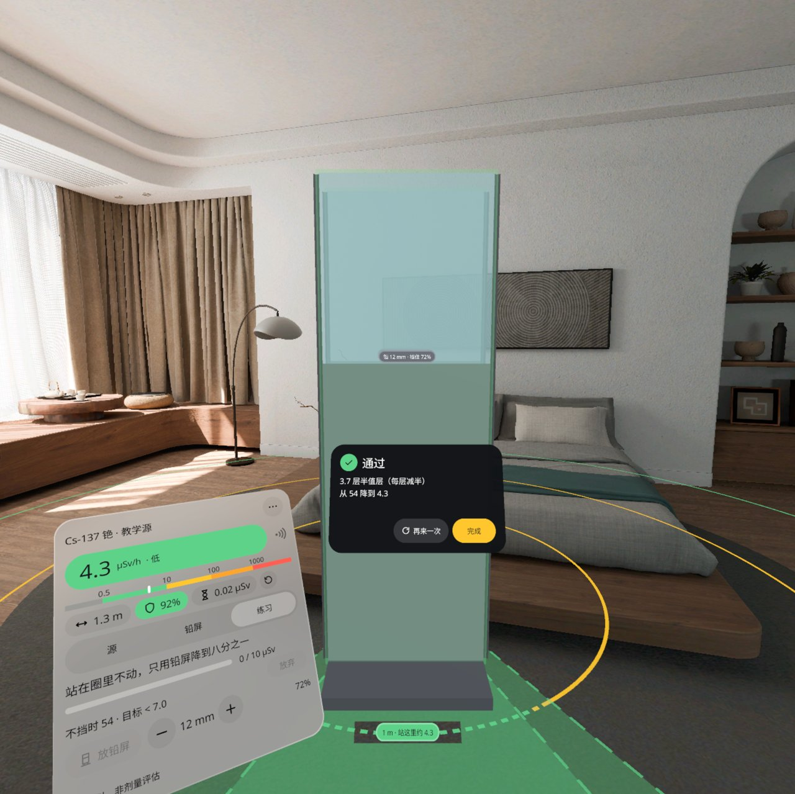
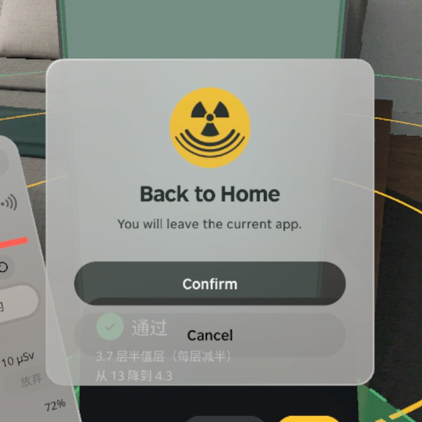

<p align="center"></p>

# Dose Distance | 剂量与距离

> ⚠️ **教学近似，非剂量评估。** 本应用里的放射源是虚拟的，读数只按平方反比和半值层做教学近似，**不能用来评估任何真实剂量**，也不能代替剂量计或辐射防护培训。
> ⚠️ **Teaching approximation, not a dose assessment.** The source is virtual and the readings are a classroom approximation (inverse square and half-value layers). **They must not be used to assess any real dose**, and do not replace a dosimeter or radiation-protection training.

**桌上一个虚拟放射源，走近一步剂量率按平方反比跳；拖一块 1:1 铅屏，它在地上投出「安全影子」，站进去读数就掉——学会时间、距离、屏蔽。**

**A virtual radioactive source sits on your real desk; step closer and the dose rate jumps by the inverse square. Drag a life-size lead shield and it casts a "safe shadow" on the floor; step into it and the reading drops. Learn time, distance and shielding.**

PICO OS 6 · PICO Spatial SDK 6.1.9 · Kotlin / SpatialUI · package `io.embodit.dosedistance` · v0.1.0 (pre-release / 预发布)

> **模拟器 QA 通过，真机未验证（Simulator-QA passed; not yet verified on a real headset）。**



> 截图和演示视频来自原生模拟器（PICO Emulator 6.1），由调试广播和模拟器相机驱动；**非真实手势录像**，演示视频无声。
> Screenshots and the demo video were taken on the native PICO emulator, driven by debug broadcasts and the emulator camera; **not a recording of real hand gestures**; the demo video has no sound.

---

## 中文

### 这是什么

辐射防护的三件事——时间、距离、屏蔽——用你自己的身体学。看着桌面或地面点一下，放下一个虚拟放射源（铅罐 + 源芯），地上画出 1 / 2 / 3 米三个环，环上按剂量率分颜色。你头部所在的位置就是剂量计：往前走一步读数按平方反比往上跳，往后退就降，面板上实时显示剂量率、所在区（低 / 中 / 高 / 极高）、离源距离和累计剂量；开着盖革声时还有咔哒声。

点「放铅屏」，一块 1.8 米高、带铅玻璃窗的移动铅屏立在地上，靠近吸附点会自动正对源；它在地上投出一片绿色「安全影子」，站进去读数就掉，加厚（1–24 mm）挡得更多，最多放两块。核素可选 Tc-99m、Cs-137、Co-60。三个练习：距离（降到开始时的四分之一）、时间（俯身读出罐口的编码再退开）、屏蔽（站在圈里不动，只用铅屏把读数降到八分之一），每个练习有剂量预算，通过给一张结果卡。中英双语，不联网。

面板最下面一直写着「教学近似，非剂量评估」。

### 安装与启动

```bash
adb shell am force-stop io.embodit.dosedistance
adb install -r DoseDistance-v0.1.0.apk
pico-cli app launch io.embodit.dosedistance
```

APK 在 [Releases](https://github.com/kejing-dev/DoseDistance/releases) 页面下载（仓库不含 APK）。需要 PICO OS 6 头显或 PICO Emulator 6.1；用到地面 / 桌面平面识别和头部位置。APK 约 34 MB。覆盖安装前先停应用。

### 容器与骨架

- **容器**：只有 Full Space · `STAGE_MIXED`（透视），没有 Shared Space 版本。源要放在真实桌面 / 地面上，读数要跟着你真实的头部位置走，铅屏 1:1 立在地上，依赖平面识别和头部位姿，只在 Full Space 可用。
- **骨架 D**（同监控盲区 Camera Coverage / 影院规划 Theater Planner / 空间尺 Spatial Ruler）：面板池、平面碰撞体、系统拖动换算、懒跟随、摇杆输入。剂量模型在纯 Kotlin 的 domain 层并有单元测试：H = h1 / max(0.3, d)² × Π 2^(−t/HVL) + 本底 0.1 µSv/h；安全影子、三个环、练习判定都在每帧系统里算，网格排队生成。
- **状态**：设计包 27 个状态（S01–S27），全部可由调试广播直接跳转并截图，结构见 [AGENTS.md](AGENTS.md)。

### 截图

| | |
|---|---|
|  |  |
| 低区 — 3.6 m，7.3 µSv/h | 中区 — 1.3 m，54 µSv/h |
|  |  |
| 极高 —「贴着源了（按 0.3 m 算）」，1.03 mSv/h | 两块 12 mm — 挡住 92%，4.3 µSv/h |
|  |  |
| 练习 · 距离 —「还差 1.5 m」+ 剂量预算 | 练习通过 — 3.7 层半值层，54 → 4.3 |

启动器图标：



### 已知问题（QA 第 1 轮，不影响使用）

- 模拟器上远处的源很小（2.4 米外只有 12 cm），鼠标不好点中，容易点到后面的家具；真机上人会走近再点。
- 仅调试路径：直接跳到「练习 2 未通过」时卡片写「超预算」而不是「超时」；真实 60 秒没读到编码会写「超时」。
- 练习 1 通过后，之前藏起来的铅屏又出现，面板读数跟着变成挡过的值；结果卡里的数字是按练习时算的，是对的，只是背后的读数第一眼会对不上。

还没在头显上验过：盖革咔哒声和空间音频、手柄摇杆转源 / 铅屏、真人走动的感觉、俯身读罐口 1.8 cm 编码看不看得清、真实桌面识别、捏住拖源和铅屏的手感、空间权限。

---

## English

### What it is

Radiation protection's three rules — time, distance, shielding — learned with your own body. Look at a desk or the floor and tap to place a virtual source (lead pot + core); 1 / 2 / 3 m rings appear on the floor, coloured by dose rate. Your head is the dosimeter: step closer and the reading rises by the inverse square, step back and it falls. The panel shows dose rate, zone (low / medium / high / extreme), distance and accumulated dose, with Geiger clicks when enabled.

Tap Place shield and a 1.8 m mobile lead shield with a lead-glass window stands on the floor, snapping to face the source near the snap point. It casts a green "safe shadow" on the floor; stand in it and the reading drops; make it thicker (1–24 mm) to block more; up to two shields. Isotopes: Tc-99m, Cs-137, Co-60. Three drills: distance (get down to a quarter of the start), time (lean over, read the code in the pot, step back), shielding (stand still in the circle and use only shields to get below an eighth), each with a dose budget and a result card. Chinese and English, offline.

The footer "Teaching approximation, not a dose assessment" is always on the panel.

### Install and launch

```bash
adb shell am force-stop io.embodit.dosedistance
adb install -r DoseDistance-v0.1.0.apk
pico-cli app launch io.embodit.dosedistance
```

Download the APK from the [Releases](https://github.com/kejing-dev/DoseDistance/releases) page (the repository itself does not ship an APK). Needs a PICO OS 6 headset or PICO Emulator 6.1; uses floor / desk plane detection and head pose. The APK is about 34 MB. Stop the app before reinstalling over it.

### Container and skeleton

- **Container**: Full Space only, `STAGE_MIXED` (passthrough); no Shared Space version. The source sits on a real desk or floor, the reading follows your real head position and the shield stands life-size on the floor, which needs plane detection and head pose — Full Space only.
- **Skeleton D** (same as Camera Coverage / Theater Planner / Spatial Ruler): panel pool, plane colliders, system-drag conversion, lazy follow, thumbstick input. The dose model is a pure, unit-tested Kotlin domain layer: H = h1 / max(0.3, d)² × Π 2^(−t/HVL) + 0.1 µSv/h background; the safe shadow, rings and drill criteria run in a per-frame system, with meshes queued across frames.
- **States**: 27 designed states (S01–S27), each reachable by a debug broadcast and captured; see [AGENTS.md](AGENTS.md).

### Screenshots

See the table above: low, medium and extreme zones, two 12 mm shields, the distance drill and a passed drill.

### Known issues (QA round 1, none blocking)

- On the emulator a distant source is tiny (12 cm at 2.4 m) and hard to click; clicks land on the furniture behind it. On a headset you walk up and tap.
- Debug path only: jumping straight to "drill 2 failed" shows "over budget" instead of "time out"; the real 60-second timeout shows "time out".
- After drill 1 passes, the shields hidden for the drill come back and the panel reading becomes the shielded value; the result card's numbers (from the drill) are right, but the live reading behind it looks inconsistent at first.

Not yet verified on a headset: Geiger clicks and spatial audio, thumbstick turning of the source / shield, walking around for real, whether the 1.8 cm pot code is readable when leaning over, real desk detection, the feel of pinch-dragging the source and shields, and the spatial permission.

---

## License

Source code © 2026 Embodit. All rights reserved (private repository). Bundled fonts Noto Sans / Noto Sans SC (subset) are under the SIL Open Font License, see `third_party/`. Dose values are a teaching approximation and carry no warranty of any kind.
